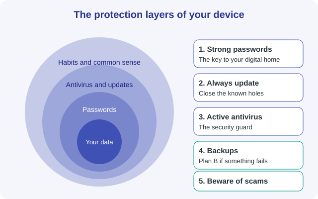

# Device security and protection

## :material-shield-check: Protect your computer and phone without being an IT expert

A **step-by-step** guide, in plain words, so anyone can protect their devices and their data.

[Start the guide :material-arrow-right:](introduccion.md){ .md-button .md-button--primary }
[See passwords :material-key:](contrasenas.md){ .md-button }

## What is this project about?

Today we keep **photos, messages, bank accounts and important documents** on our computer and phone. If someone gets into them, or they break, the problem can be serious.

This website explains, without technical jargon, **what to do to stay protected**. You don't need to know about computers: just follow the steps.

## What will you learn?

-   :material-key:{ .lg .middle } **Passwords**

    ---

    How to create secure passwords and not forget them.

    [:octicons-arrow-right-24: Go to passwords](contrasenas.md)

-   :material-update:{ .lg .middle } **Updates**

    ---

    Why updating your device protects you.

    [:octicons-arrow-right-24: Go to updates](actualizaciones.md)

-   :material-virus-off:{ .lg .middle } **Antivirus**

    ---

    Check that your protection is switched on.

    [:octicons-arrow-right-24: Go to antivirus](antivirus.md)

-   :material-backup-restore:{ .lg .middle } **Backups**

    ---

    Save your things in case something goes wrong.

    [:octicons-arrow-right-24: Go to backups](copias-seguridad.md)

-   :material-fishing:{ .lg .middle } **Phishing and scams**

    ---

    Spot fake messages before falling for them.

    [:octicons-arrow-right-24: Go to phishing](phishing.md)

-   :material-wifi-lock:{ .lg .middle } **Secure Wi-Fi**

    ---

    Use Wi-Fi networks without risks.

    [:octicons-arrow-right-24: Go to Wi-Fi](wifi.md)

## Authors

Project made by **Pedro Jesus Cruz** and **Alejandro Rodriguez** as a technical documentation exercise with MkDocs and GitHub Pages.

!!! info "Instructions for Mac and Windows"
    Where the system matters you will see **tabs** to choose between **Windows** and **macOS**.
