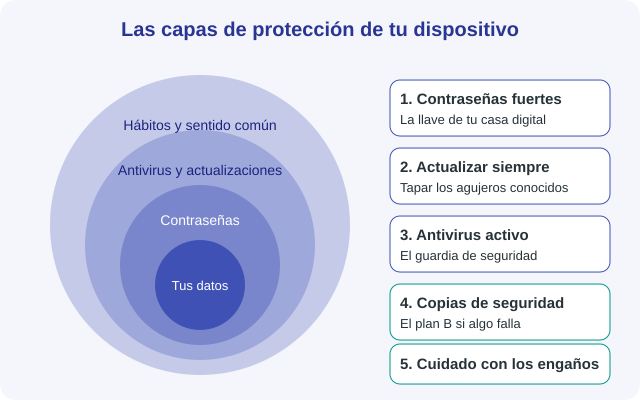

# Seguridad y protección del dispositivo

## :material-shield-check: Protege tu ordenador y tu móvil sin ser informático

Una guía **paso a paso**, con palabras sencillas, para que cualquier persona pueda proteger sus dispositivos y sus datos.

[Empezar la guía :material-arrow-right:](introduccion.md){ .md-button .md-button--primary }
[Ver las contraseñas :material-key:](contrasenas.md){ .md-button }

## ¿De qué trata este proyecto?

Hoy guardamos en el ordenador y en el móvil **fotos, mensajes, cuentas del banco y documentos importantes**. Si alguien accede a ellos o se estropean, el problema puede ser grande.

Esta web explica, sin tecnicismos, **qué hacer para estar protegido**. No hace falta saber de informática: solo seguir los pasos.

## ¿Qué vas a aprender?

-   :material-key:{ .lg .middle } **Contraseñas**

    ---

    Cómo crear contraseñas seguras y no olvidarlas.

    [:octicons-arrow-right-24: Ir a contraseñas](contrasenas.md)

-   :material-update:{ .lg .middle } **Actualizaciones**

    ---

    Por qué actualizar tu dispositivo te protege.

    [:octicons-arrow-right-24: Ir a actualizaciones](actualizaciones.md)

-   :material-virus-off:{ .lg .middle } **Antivirus**

    ---

    Comprobar que tu protección está encendida.

    [:octicons-arrow-right-24: Ir a antivirus](antivirus.md)

-   :material-backup-restore:{ .lg .middle } **Copias de seguridad**

    ---

    Guardar tus cosas por si algo sale mal.

    [:octicons-arrow-right-24: Ir a copias](copias-seguridad.md)

-   :material-fishing:{ .lg .middle } **Phishing y estafas**

    ---

    Reconocer mensajes falsos antes de caer.

    [:octicons-arrow-right-24: Ir a phishing](phishing.md)

-   :material-wifi-lock:{ .lg .middle } **Wi-Fi seguro**

    ---

    Usar redes Wi-Fi sin riesgos.

    [:octicons-arrow-right-24: Ir a Wi-Fi](wifi.md)

## Autores

Proyecto realizado por **Pedro Jesus Cruz** y **Alejandro Rodriguez** como práctica de documentación técnica con MkDocs y GitHub Pages.

!!! info "Instrucciones para Mac y Windows"
    En los pasos donde cambia el sistema verás **pestañas** para elegir entre **Windows** y **macOS**.
