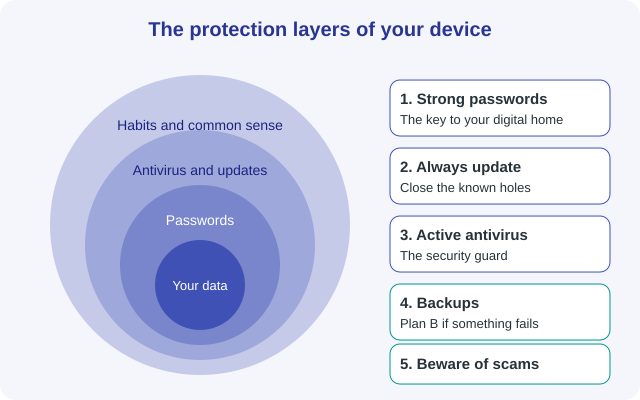

# Introduction

## What does "device security" mean?

Your **device** is the computer, phone or tablet you use every day. **Protecting your device** means preventing:

- Someone from **getting in without permission** to your accounts or files.
- A **virus** from damaging it or spying on what you do.
- **Losing your data** because of a failure, theft or a mistake.
- A **trick** (for example, a fake message) from making you hand over your passwords.

!!! tip "A simple idea"
    Think of your device as **your home**: it needs a good key (password), up-to-date locks (updates), an alarm (antivirus), a copy of what matters kept elsewhere (backups) and caution about who knocks at the door (phishing).

## Why does it matter?

Cybercriminals usually don't look for specific people: they look for **whoever makes it easy**. Most attacks work through basic carelessness, not sophisticated techniques.

| Risk | Everyday example | What prevents it |
|---|---|---|
| Account theft | Someone guesses your email password | [Strong passwords](contrasenas.md) |
| Viruses and malicious programs | You download a "free" program with a catch | [Antivirus](antivirus.md) and [updates](actualizaciones.md) |
| Data loss | Your disk breaks and you lose your photos | [Backups](copias-seguridad.md) |
| Scams | A fake SMS claims to be from your bank | [Phishing](phishing.md) |
| Unsafe networks | You use a café's Wi-Fi carelessly | [Secure Wi-Fi](wifi.md) |

## The five layers of protection

No single measure is perfect. What works is **adding layers**, as shown in the picture:

## Glossary to get started

??? question "What is a virus?"
    A program that gets into your device without you knowing and does harmful things: deletes files, spies on you or demands money.

??? question "What is an update?"
    An improvement released by the maker (Apple, Microsoft...) to fix bugs and **close doors** that criminals could use.

??? question "What is phishing?"
    A trick by email, SMS or message that imitates a real company (bank, post office...) so you hand over your data.

??? question "What is a backup?"
    A copy of your important files kept in another place (external drive or cloud) so you can recover them if you lose the originals.

??? question "What is two-step verification?"
    A second check when logging in, usually a code on your phone. Even if someone steals your password, they can't get in without that code.

## How to use this guide

1. Read the [Before you start](requisitos.md) section.
2. Follow the guide pages **in order**.
3. Tick each step when you complete it.
4. At the end, review the [final checklist](conclusiones.md).
