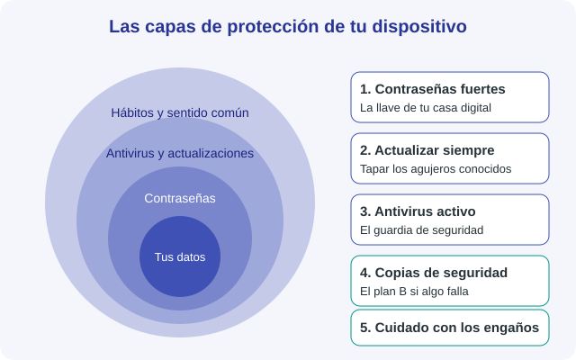

# Introducción

## ¿Qué significa "seguridad del dispositivo"?

Tu **dispositivo** es el ordenador, el móvil o la tablet que usas cada día. **Proteger tu dispositivo** significa evitar que:

- Alguien **entre sin permiso** en tus cuentas o archivos.
- Un **virus** lo estropee o espíe lo que haces.
- **Pierdas tus datos** por un fallo, un robo o un descuido.
- Un **engaño** (por ejemplo, un mensaje falso) te haga entregar tus claves.

!!! tip "Una idea sencilla"
    Piensa en tu dispositivo como **tu casa**: necesita una buena llave (contraseña), cerraduras al día (actualizaciones), alarma (antivirus), una copia de lo importante en otro sitio (copias de seguridad) y cuidado con quién llama a la puerta (phishing).

## ¿Por qué es importante?

Los ciberdelincuentes no suelen buscar a personas concretas: buscan **a quien se lo pone fácil**. La mayoría de los ataques funcionan por descuidos básicos, no por técnicas sofisticadas.

| Riesgo | Ejemplo cotidiano | Qué lo evita |
|---|---|---|
| Robo de cuentas | Alguien adivina tu contraseña de correo | [Contraseñas fuertes](contrasenas.md) |
| Virus y programas maliciosos | Descargas un programa "gratis" con trampa | [Antivirus](antivirus.md) y [actualizaciones](actualizaciones.md) |
| Pérdida de datos | Se rompe el disco y pierdes las fotos | [Copias de seguridad](copias-seguridad.md) |
| Engaños | Un SMS falso dice ser de tu banco | [Phishing](phishing.md) |
| Redes inseguras | Usas el Wi-Fi de una cafetería sin cuidado | [Wi-Fi seguro](wifi.md) |

## Las cinco capas de protección

Ninguna medida es perfecta por sí sola. Lo que funciona es **sumar capas**, como se ve en la imagen:

## Glosario para empezar

??? question "¿Qué es un virus?"
    Un programa que se mete en tu dispositivo sin que lo sepas y hace cosas dañinas: borrar archivos, espiar o pedirte dinero.

??? question "¿Qué es una actualización?"
    Una mejora que envía el fabricante (Apple, Microsoft...) para arreglar fallos y **cerrar puertas** que los delincuentes podrían usar.

??? question "¿Qué es el phishing?"
    Un engaño por correo, SMS o mensaje que imita a una empresa real (banco, correos...) para que entregues tus datos.

??? question "¿Qué es una copia de seguridad?"
    Una copia de tus archivos importantes guardada en otro lugar (disco externo o nube) para recuperarlos si pierdes los originales.

??? question "¿Qué es la verificación en dos pasos?"
    Una segunda comprobación al entrar en una cuenta, normalmente un código en tu móvil. Aunque alguien robe tu contraseña, no podrá entrar sin ese código.

## Cómo usar esta guía

1. Lee la sección [Antes de empezar](requisitos.md).
2. Sigue las páginas de la guía **en orden**.
3. Marca cada paso cuando lo completes.
4. Al terminar, repasa la [lista final](conclusiones.md).
